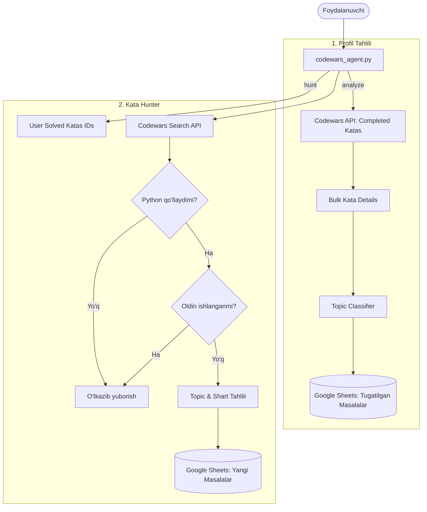

# 🥋 Codewars Agent

Foydalanuvchining **Codewars** profilini tahlil qiluvchi, ishlangan masalalarni sof dasturlash mavzulari bo'yicha saralovchi hamda yangi (ishlanmagan) masalalarni qidirib topib **Google Sheets**ga professional ko'rinishda yozuvchi intellektual agent.

---

## 📌 Asosiy Imkoniyatlar

1. **📊 Profil Tahlili (`analyze`):**
   - Codewars API orqali foydalanuvchi yechgan barcha masalalarni (completed katas) avtomatik yuklash.
   - Har bir masalaning nomi, sharti (description) va teglarini ko'p oqimli (multi-threaded) parallel rejimda o'qish.
   - Masalalarni mavhum sohalar bo'yicha emas, balki **haqiqiy Python sintaksisi va dasturlash tushunchalari** bo'yicha 12+ mavzuga ajratish.
   - Barcha ma'lumotlarni Google Sheets'ga sahifalar (tabs) bo'yicha formatlangan holda yozish.

2. **🎯 Yangi Masalalar Qidiruvi (`hunt` — Kata Hunter):**
   - **Qat'iy 0% Dublikat Kafolati:** Foydalanuvchi ilgari ishlagan masalalar bazasi (`solved_ids`) bilan solishtiriladi va qayta taklif qilinmaydi.
   - **Faqat Python Dasturlash Tili:** Faqat Python tilida yechilishi mumkin bo'lgan masalalar olinadi (`'python' in languages`).
   - **Mavzu va Mohiyat Tahlili:** Masala sharti va algoritmi chuqur tahlil qilinib, haqiqatan ham so'ralgan mavzuga (masalan, `while_loop` yoki `for_loop`) tegishliligi tekshiriladi.
   - **Daraja Filtrlash:** Aniq kyu darajasi (masalan, `8 kyu`, `7 kyu`, `6 kyu`...) bo'yicha saralash.
   - Natijalarni Google Sheets'dagi tegishli sahifaga qo'shish yoki yangilash.

3. **📑 Google Sheets Professional Formatlash:**
   - 2-rasm andozasi bo'yicha to'q yashil (`#0D6133`) qotirilgan sarlavha (freeze header).
   - Masala nomlari bosiladigan giperhavola ko'rinishida (`=HYPERLINK(...)`).
   - Qiyinlik darajasi (`Basic`: 8–7 kyu, `Advanced`: 6–1 kyu).

---

## 🏗️ Arxitektura va Ishlash Sxemasi



---

## 📂 Loyiha Tuzilishi

```text
codewars_agent/
├── codewars_agent.py          # Asosiy CLI skript (Kirish nuqtasi)
├── AGENTS.md                  # Agent qoidalari va standartlari
├── README.md                  # Loyiha hujjatlari
├── requirements.txt           # Kerakli Python paketlari
├── credentials.json           # Google Service Account kaliti
└── .agents/
    └── skills/
        └── codewars-agent/
            ├── SKILL.md       # Agent qobiliyatlari va yo'riqnomasi
            └── tools/
                ├── codewars_client.py   # Codewars API & Qidiruv moduli
                ├── sheets_client.py     # Google Sheets formatlash & API moduli
                └── topic_classifier.py  # Masalalar mavzusini tahlil qiluvchi modul
```

---

## ⚙️ O'rnatish va Sozlash

### 1. Repozitoriyani sozlash
```bash
git clone <repo-url>
cd codewars_agent
```

### 2. Virtual muhitni ishga tushirish va bog'liqliklarni o'rnatish
```bash
python3 -m venv env
source env/bin/activate
pip install -r requirements.txt
```

### 3. Google Sheets Service Account kaliti
Loyihaning ildiz papkasida `credentials.json` fayli mavjud bo'lishi kerak.
Ushbu hisob pochtasi Google Sheets jadvallariga **Editor (Tahrirlovchi)** huquqi bilan ulangan bo'lishi shart:
- **Bot pochtasi:** `sheet-bot@light-rhythm-504607-j1.iam.gserviceaccount.com`

---

## 🚀 Foydalanish

Loyiha terminaldan CLI orqali ikki xil rejimda boshqariladi:

### 1. Foydalanuvchi profilini tahlil qilish (`analyze`)

Foydalanuvchining barcha yechgan masalalarini yuklab, mavzularga ajratadi va jadvalga yozadi:

```bash
python codewars_agent.py analyze --user <USERNAME> [--sheet <SHEET_ID>]
```

**Misol:**
```bash
python codewars_agent.py analyze --user Sanjar_2002
```

> **Izoh:** `--sheet` berilmasa, standart `AGENTS.md`da ko'rsatilgan jadval ishlatiladi (`17_vwGPdOGXwsiukClGIV4snpjOw-vRu4Ob67VPY2GrM`).

---

### 2. Yangi masalalar qidirish (`hunt`)

Foydalanuvchi ilgari **ishlamagan**, faqat **Python** tilida yechiladigan yangi masalalarni topadi va jadvalga qo'shadi:

```bash
python codewars_agent.py hunt --user <USERNAME> --topic <TOPIC> --kyu <KYU> [--count <COUNT>] [--sheet <SHEET_ID>]
```

**Misollar:**
```bash
# while_loop mavzusidan 8 kyu darajasidagi 5 ta yangi masala topish:
python codewars_agent.py hunt --user Sanjar_2002 --topic "while_loop" --kyu "8 kyu" --count 5

# for_loop mavzusidan 7 kyu darajasidagi 10 ta yangi masala topish:
python codewars_agent.py hunt --user Sanjar_2002 --topic "for_loop" --kyu "7 kyu" --count 10

# string mavzusidan 8 kyu masalalarni qidirish:
python codewars_agent.py hunt --user Sanjar_2002 --topic "string" --kyu "8 kyu" --count 10
```

---

## 🏷️ Qo'llab-quvvatlanadigan Mavzular (Topics)

Masalalar Codewars'dagi noaniq teglarga emas, balki haqiqiy dasturlash sintaksisiga qarab quyidagi mavzularga ajratiladi:

| Mavzu ID | Tavsifi |
| :--- | :--- |
| `while_loop` | Shart bajarilguniga qadar takrorlanuvchi jarayonlar, simulyatsiyalar, qadamlar soni |
| `for_loop` | `range(...)` orqali iteratsiyalar, ketma-ketliklar, n marta takrorlanishlar, shakl chizish |
| `if_related_homework` | Shart operatorlari (`if`, `elif`, `else`), mantiqiy tarmoqlanish, taqqoslashlar |
| `arithmetic_operators` | Arifmetik amallar, matematik formulalar, koordinatalar, burchaklar, konvertatsiya |
| `string` | Satrlar va metodlari (`strip`, `split`, `replace`, slicing, palindrom...) |
| `list` | Ro'yxatlar va massivlar (`append`, `pop`, indexing, list comprehension...) |
| `dictionary` | Lug'atlar (`dict`, kalit-qiymat, hashmap, mapping) |
| `built_in` | O'rnatilgan funksiyalar (`len`, `min`, `max`, `sum`, `abs`, `round`, `math`...) |
| `oop` | Obyektga yo'naltirilgan dasturlash (`class`, `__init__`, metodlar, merosxo'rlik) |
| `regular_expressions` | Muntazam ifodalar (`re` moduli, pattern matching) |
| `algorithms` | Algoritmlar, saralash (sorting), rekursiya, binar qidiruv, sonlar nazariyasi |
| `logics` | Mantiqiy operatorlar (`and`, `or`, `not`, boolean taqqoslashlar) |
| `fundamentals_umumiy` | Yuqoridagi toifalarga kirmagan eng oddiy umumiy sintaksis |

---

## 📊 Google Sheets Jadval Standarti

Har bir mavzu sahifasi (worksheet) quyidagi tartibda shakllantiriladi:

1. **Jadval Ustunlari:**
   - `# Column 1` — Masalaning tartib raqami (1, 2, 3...)
   - `Problem name` — Bosiladigan havola: `=HYPERLINK("<url>", "<nomi> \| Codewars")`
   - `Problem id` — 24 xonali unikal Codewars ID
   - `topic` — Mavzu nomi (masalan: `while_loop`)
   - `Difficulty` — `Basic` (8–7 kyu) yoki `Advanced` (6–1 kyu)
   - `Lanaguage` — Dasturlash tili (`Python`)

2. **Dizayn Standarti:**
   - **Header foni:** To'q yashil (`#0D6133` / RGB: 13, 97, 51)
   - **Header matni:** Oq rang, qalin (bold), 10pt
   - **Qotirish:** 1-qator muzlatilgan (Freeze 1 row)

---

## 🔗 Loyihaga Biriktirilgan Google Sheet Jadvallari

- 📗 **[Tugatilgan Masalalar Jadvali](https://docs.google.com/spreadsheets/d/17_vwGPdOGXwsiukClGIV4snpjOw-vRu4Ob67VPY2GrM/edit?usp=sharing)**
- 📘 **[Yangi Qidirilgan Masalalar Jadvali](https://docs.google.com/spreadsheets/d/1VWc8OrNu-d-aj33zMq0hSBR7r5lf0jczVmQdHGnCZPs/edit?usp=sharing)**
- 📙 **[Qo'shilmagan Masalalar (Diff) Jadvali](https://docs.google.com/spreadsheets/d/1DwIWV45q2bvraAnd1EIw-BmJzfJfLOGSgdrhhIDE3KE/edit?usp=sharing)**

---

## 📜 Litsenziya va Mualliflik

Ushbu loyiha ichki foydalanish va Codewars orqali Python dasturlashni tizimli o'rganish va o'rgatish maqsadida yaratilgan.
